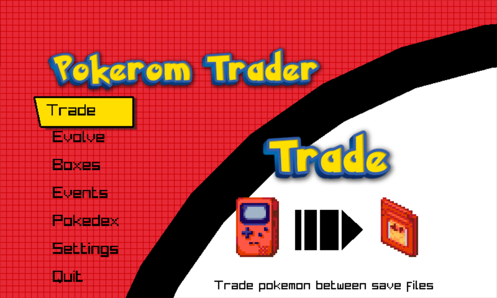
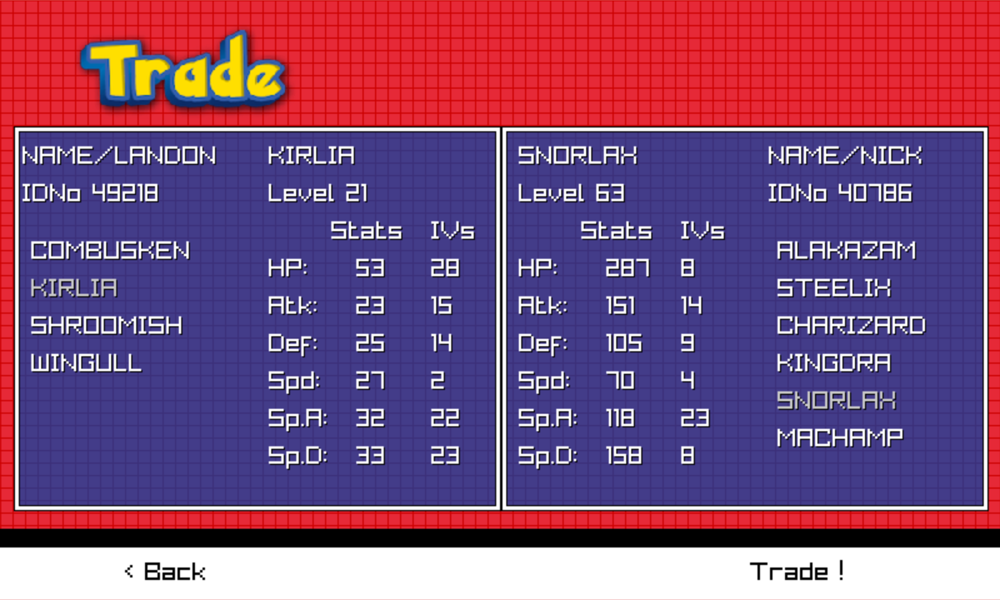
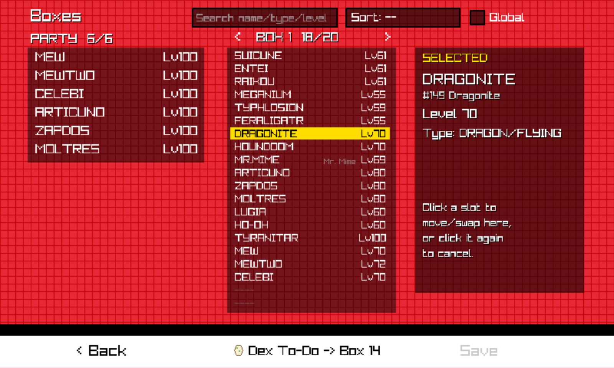
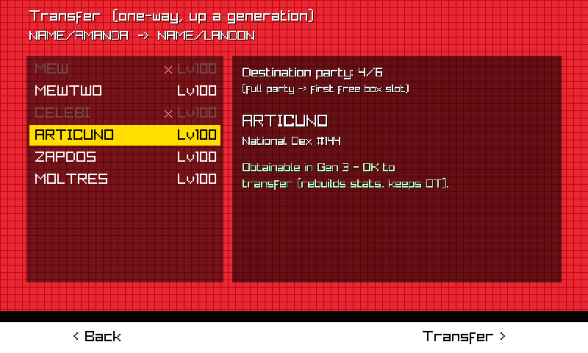
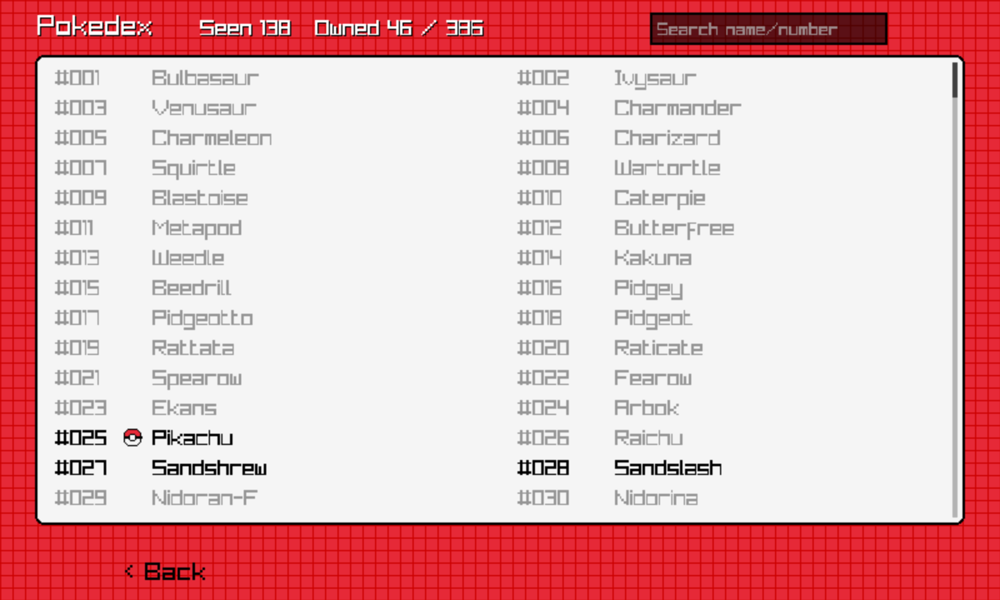

# Pokerom Trader - Pokémon Save File Trading GUI

Trade Pokémon between your save files, evolve trade evolutions, manage your PC boxes and carry Pokémon forward from Red/Blue all the way to Diamond/Pearl, without a second console or a link cable. It works on the save files your emulator or cartridge dumper already gives you, and it does what the games themselves would do, so the Pokémon stay legitimate.

> **About this fork:** Pokerom Trader was created by Spencer Vaughn ([savaughn/pokerom-trader](https://github.com/savaughn/pokerom-trader), MIT) on the [PKSav](https://github.com/savaughn/pksav) library (MIT). This fork continues it with Gen 3 and Gen 4 support, forward transfers, Bill's PC, a Pokédex view, events and many fixes. All original attribution and the MIT license are retained; see [LICENSE](LICENSE) and [Acknowledgments](#acknowledgments).

  

## Supported games

| Generation | Games (US/English saves) |
|---|---|
| Gen 1 | Red, Blue, Yellow |
| Gen 2 | Gold, Silver, Crystal |
| Gen 3 | Ruby, Sapphire, Emerald, FireRed, LeafGreen |
| Gen 4 | Diamond, Pearl, Platinum, HeartGold, SoulSilver |

## Screenshots

| Trade | Bill's PC |
|---|---|
|  |  |
| **Transfer forward** | **Pokédex** |
|  |  |

## Features

- **Trade** between two saves of the same generation, or between Gen 1 and Gen 2 the way the Time Capsule does (only Pokémon and moves both games have).
- **Evolve** Pokémon that only evolve by trading, including held-item evolutions (Metal Coat, King's Rock, Dragon Scale, Up-Grade, DeepSeaTooth/Scale). An Everstone blocks it, as in the games.
- **Transfer forward**, one way, the way the games move Pokémon up a generation:
  - Gen 1/2 → Gen 3: keeps the OT, level, moves, PP Ups, held item, gender, shininess and Unown letter.
  - Gen 3 → Gen 4 (Pal Park): keeps the OT, PID, IVs, EVs, ability, ribbons, markings, met data and more, following the real Pal Park rules.
  - The source save loses the Pokémon, so nothing is cloned.
- **Bill's PC**: browse the party and every box, deposit, withdraw and swap, move between boxes, sort and search. It follows the games' rules: no boxing Mail holders, and never leaving the party without a Pokémon that can battle.
- **Pokédex**: see what each save has seen and caught, with a to-do list that points to Pokémon you own but haven't registered, or could evolve or breed.
- **Events**: re-issue the distribution items that unlock in-game events, so the cartridge itself generates the Pokémon when you play to the spot. The GS Ball (Crystal → Celebi), Eon Ticket (R/S/E → Latias/Latios), Mystic Ticket (E/FR/LG → Lugia & Ho-Oh), Aurora Ticket (E/FR/LG → Deoxys) and Old Sea Map (Emerald → Mew). It can also give Gen 3 saves the 2006 US 10th Anniversary Celebi as a real distribution would.

## Your saves are safe

- The first time a save is written in a session, the app copies the original file to `<save>_bak`.
- Two-save operations (trades, transfers) are written to temporary files and committed together: if anything fails, neither save changes.
- If an emulator wrote the file after the app loaded it, the app refuses to overwrite it and reloads instead.
- The app rewrites everything the games verify on load (checksums for every generation, and Gen 2's backup copy of the save), so an edited save loads in-game like a normal one.

As with any save tool, try results in an emulator before writing them to a real cartridge.

## Getting started

Download the Windows build from the [releases page](https://github.com/sonofskywalker3/pokerom-trader/releases) and run it. Put your `.sav` files in `Documents\PokeromTrader\saves`, choose another folder in Settings, or drag and drop saves onto the file list.

| Platform | Status | Default save folder |
|---|---|---|
| Windows x64 | Release build | `<UserProfile>\Documents\PokeromTrader\saves` |
| Linux, macOS | Build from source (not yet tested on this fork's latest changes) | `~/.pokeromtrader/saves`, `~/Library/Application Support/PokeromTrader/saves` |
| Android | Planned | |

### Controls

- Select a save file or Pokémon: **click**
- Scroll lists: **mouse wheel**, **↑ / ↓ arrow keys**, or click and drag
- Resize the window by dragging any edge; a taller window shows more of the list
- Back / exit a screen: **Esc**

## Known limitations

- US/English saves only; Japanese saves and ROM hacks that change the save layout aren't supported.
- **Events:** the Emerald events are verified in-emulator. FireRed/LeafGreen and Ruby/Sapphire use the same mechanism with flags from the game disassemblies but haven't been play-tested on those games yet.
- Gen 3 and Gen 4 boxed Pokémon show no level in Bill's PC (the games don't store one).
- Bug reports and requests: [issues](https://github.com/sonofskywalker3/pokerom-trader/issues).

## Building from source

See the [Contributing Guide](CONTRIBUTING.md). On Windows any MinGW-w64 GCC works (for example the one bundled with Strawberry Perl); run the tests with `make test` and build the command-line tool with `make pkcli`.

## Contributing
 
 [Contributing Guide](CONTRIBUTING.md)

## License

This project is licensed under the [MIT License](LICENSE).

## Acknowledgments

- [Raylib](www.github.com/raysan5/raylib): Thank you to the creators and maintainers of Raylib for providing the library that makes this project possible.
- [Bulbapedia](https://bulbapedia.bulbagarden.net/wiki/Main_Page): Thank you to the creators and maintainers of Bulbapedia for providing the information that makes this project possible.
- [TextStudio](https://www.textstudio.com/logo/pokemon-3d-text-318): Used their text generator for stylized text.
- [Cazwolf](https://cazwolf.itch.io/caz-pixel-consoles): Used their pixel art for the consoles and catridges.
- [Miguel PM Romeu](https://miguel-pm-romeu.itch.io/pack-of-pokeballs): Modified their pokeball sprites.

## Disclaimer
Pokerom Trader is an unofficial application and is not affiliated with or endorsed by Nintendo, Game Freak, Creatures, The Pokémon Company, or any related entities. Pokémon and Pokémon character names are trademarks of Nintendo, Game Freak, Creatures, and The Pokémon Company. All trademarks, character names, and other intellectual property used in this application are used for identification and informational purposes only. The use of these names and marks is believed to qualify as fair use under trademark law. Pokerom Trader is not endorsed by or affiliated with any of the aforementioned entities. Pokerom Trader is provided "as is" without warranty of any kind, and the developers make no warranties, express or implied, regarding the accuracy or completeness of the content provided in this application.

## Demos
### Trade

### Evolve

